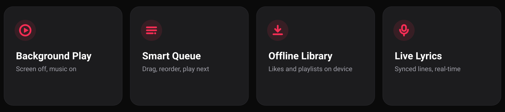

<div align="center">




# Aurix

### Listen Without Limits!

**A music player for Android. Search, queue, play — with the screen off.**
No account · No ads · No backend · No tracking

</div>



---

## ✨ What Aurix Is

- A **free, open-source** music player you sideload and own — no sign-up wall, no subscription.
- Everything you build (likes, playlists, history, queue) lives **on your device only**.
- The only network calls are the ones needed to search and stream the track **you** picked.
- Designed dark-first, one-hand friendly, with an Apple-style full-screen player.

## 🎧 Features

- **Search** — songs, artists, albums and playlists with artwork and durations.
- **Background playback** — keeps playing with the screen locked, via a foreground service.
- **Lock-screen controls** — play/pause and skip straight from the notification.
- **Queue** — add, remove, drag-reorder, play-next, shuffle and repeat (off / all / one).
- **Library** — liked songs, your playlists, imported public playlists, downloaded music.
- **History** — what you played and when; resumes exactly where you left off.
- **Live lyrics** — synced line-by-line, auto-scrolled, tap a line to seek.
- **Dynamic player** — background colour extracted from the album art, Apple-style.
- **Real seek bar** — drag to scrub, not a decoration.

## 🧱 Tech Stack

| Layer      | Used                                  |
| ---------- | ------------------------------------- |
| Framework  | React Native 0.86 + Expo SDK 57       |
| Language   | TypeScript                            |
| Navigation | React Navigation 7 (tabs + stack)     |
| Audio      | react-native-track-player v5          |
| Streams    | NewPipe Extractor (native module)     |
| Storage    | AsyncStorage (100% local)             |
| Fonts      | Outfit (300–900)                      |

## 🗂 Project Structure

```text
├── App.tsx                  # providers + font gate
├── app.json                 # expo config + android permissions
├── modules/note-native      # kotlin module: stream resolution
├── plugins                  # expo config plugins (abis, desugaring, signing)
└── src
    ├── components           # common / lists / player UI
    ├── constants/theme.ts   # colours, spacing, fonts
    ├── data                 # catalogue + mock fallbacks
    ├── hooks                # usePlayer, useLibrary, useSearch
    ├── navigation           # root stack + tab bar
    ├── playback             # engine, queue, preloader
    ├── screens              # home, explore, library, profile, player
    └── services             # music, library, lyrics
```

## 🚀 Run It Yourself

1. **Prerequisites** — Node 20+, JDK 17+, Android SDK with `ANDROID_HOME` set.
2. **Clone** — `git clone https://github.com/byhayush-commits/Aurix2.0.git` then `cd Aurix2.0`.
3. **Install** — `npm install`.
4. **Generate native project** — `npx expo prebuild --platform android` (the `android/` folder is gitignored by design).
5. **Run** — `npm run android` on a connected device or emulator.
6. **Release** — supply your own signing key and run the Gradle release task; the published keystore is never committed.

> Re-run `prebuild` after pulling changes that touch native config or plugins.

## 🛠 Builder

**Ayush** — design, code, everything.

-  Instagram — [@vivac_ayu](https://www.instagram.com/vivac_ayu)
-  GitHub (real — follow me here) — [@ayush143-maker](https://github.com/ayush143-maker)
-  Source code — [byhayush-commits/Aurix2.0](https://github.com/byhayush-commits/Aurix2.0)

<div align="center">


</div>
